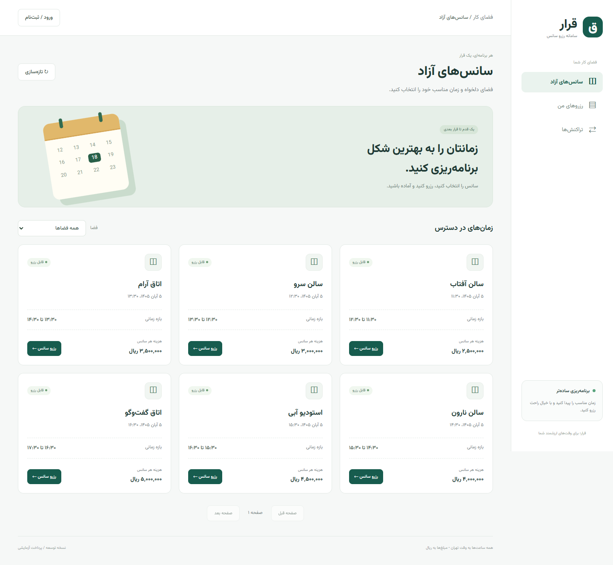

# سامانه رزرو | Reservation System

پایهٔ اجرایی سامانه رزرو سانس با **FastAPI، React و TypeScript**، مبتنی بر MVC، سرویس‌های کاربردی، Repository و تزریق وابستگی. تفسیر تصویر و فرض‌های تجاری در [مستند نیازمندی‌ها](docs/requirements.md) ثبت شده‌اند.

امکانات پیاده‌شده: ثبت‌نام و ورود، نقش مدیر/مشتری، مدیریت فضای قابل رزرو و سانس، رزرو انحصاری، لغو رزرو پرداخت‌نشده، پرداخت آزمایشی تکرارپذیر بدون ثبت مجدد، تاریخچه تراکنش و رابط فارسی راست‌به‌چپ. درگاه بانکی واقعی، استرداد وجه و انقضای خودکار رزرو در این نسخه وجود ندارند.



## اجرای سریع با Docker در WSL

```bash
cp .env.example .env
# برای کلید اختصاصی: python3 -c 'import secrets; print(secrets.token_urlsafe(48))'
# مقدار APP_SECRET_KEY و POSTGRES_PASSWORD را در .env تنظیم کنید.
docker compose up --build -d
docker compose exec api python -m app.cli create-admin
```

فرانت: http://localhost:8080 — API و Swagger: http://localhost:8000/docs

ساخت مدیر تعاملی است؛ رمز در مخزن یا لاگ ذخیره نمی‌شود. با حساب مدیر در رابط وب، فضا و سانس آینده بسازید؛ سپس با حساب مشتری رزرو و پرداخت آزمایشی را انجام دهید. پایگاه داده در volume پایدار PostgreSQL نگهداری می‌شود. `docker compose down` داده را حفظ می‌کند.

## توسعه محلی و بررسی کیفیت

Python 3.12+، Node 24 LTS و npm لازم است. مراحل کامل، اجرای SQLite، PostgreSQL، migration و تست در [راهنمای توسعه](docs/development.md) است.

```bash
cd backend
python3 -m venv .venv
source .venv/bin/activate
pip install -r requirements-dev.lock
pip install -e . --no-deps
alembic upgrade head
python -m app.cli create-admin
uvicorn app.main:app --reload
```

در ترمینال دوم:

```bash
cd frontend
npm ci
npm run dev
```

Vite درخواست‌های `/api` را به پورت 8000 می‌فرستد. برای توسعه محلی فایل env لازم نیست؛ تنظیمات پیش‌فرض فقط برای localhost و SQLite هستند.

## مستندات

- [نیازمندی‌ها، محدوده و تفسیر تصویر](docs/requirements.md)
- [معماری MVC، SOLID و مرز لایه‌ها](docs/architecture.md)
- [مدل داده و چرخه رزرو/پرداخت](docs/data-model.md)
- [قرارداد API و مثال‌ها](docs/api.md)
- [توسعه، تست و استقرار](docs/development.md)
- [امنیت و محدودیت‌های عملیاتی](docs/security.md)
- [تصمیم‌های معماری](docs/adr/0001-layered-monolith.md)
- [مشارکت و استاندارد کدنویسی](CONTRIBUTING.md)

مجوز پروژه: [MIT](LICENSE).
