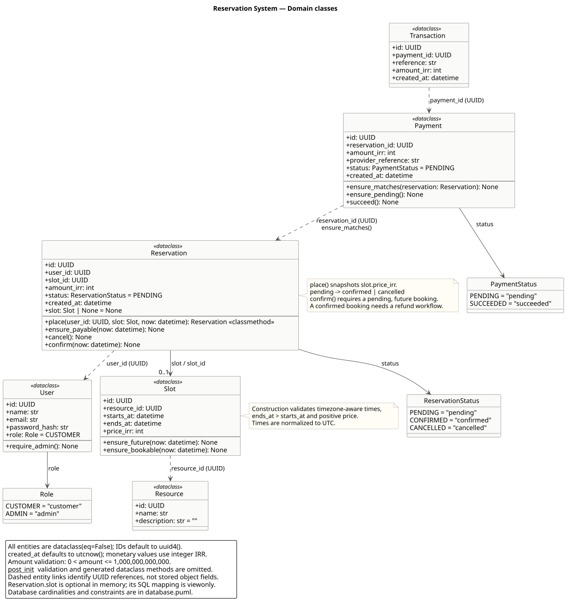
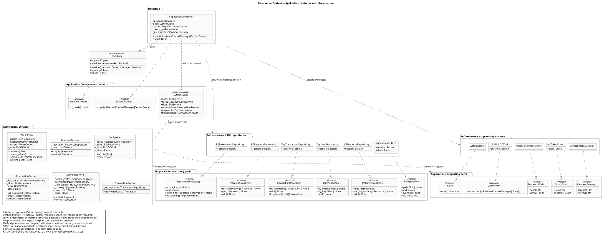

# معماری بک‌اند

بک‌اند یک monolith لایه‌ای است. هر موجودیت، مدل persistence و Repository فایل جدا دارد؛ سرویس‌ها، کنترلرها و schemaها بر اساس حوزه تفکیک شده‌اند.

## کلاس‌دیاگرام

کلاس‌ها در دو نمای مرتبط مستند شده‌اند: [موجودیت‌ها و رفتارهای دامنه](diagrams/domain-classes.svg) ([PlantUML](diagrams/domain-classes.puml)) و [سرویس‌ها، قراردادها و آداپتورها](diagrams/application-classes.svg) ([PlantUML](diagrams/application-classes.puml)). توضیح نمادها، محدودهٔ هر نما و دستور بازسازی در [راهنمای دیاگرام‌ها](diagrams/README.md) آمده است.





## ساختار

```text
backend/app/
├── domain/
│   ├── entities/          user, resource, slot, reservation, payment, transaction
│   ├── errors/            خطاهای دامنه بدون کد HTTP
│   ├── time.py
│   └── validation.py
├── application/
│   ├── commands/          ورودی معتبر مشترک بین HTTP و CLI
│   ├── dto/               خروجی عملیات کاربردی
│   ├── ports/             قرارداد جدا برای هر Repository، درگاه، زمان، توکن و UoW
│   ├── services/          auth, resources, slots, reservations, payments, transactions
│   └── service_scope.py   مجموعهٔ سرویس‌های هم‌عمر یک درخواست
├── infrastructure/
│   ├── persistence/
│   │   ├── models/        یک Table و mapping برای هر موجودیت
│   │   ├── repositories/  یک پیاده‌سازی SQL برای هر قرارداد
│   │   ├── database.py    طول عمر Session و readiness
│   │   ├── engine.py
│   │   └── unit_of_work.py
│   ├── security/          Argon2 و JWT در آداپتورهای جدا
│   ├── payments/          درگاه آزمایشی
│   └── clock.py
├── api/
│   ├── controllers/       کنترلر جدا برای هر حوزه
│   ├── schemas/           schemaهای هر موجودیت و احراز هویت
│   ├── dependencies/      دریافت قراردادها و سرویس‌ها از provider
│   ├── error_handlers.py  تبدیل خطای دامنه به HTTP
│   └── router.py
├── bootstrap/container.py اتصال پیاده‌سازی‌های واقعی به قراردادها
├── cli.py
└── main.py
```

enum وضعیت کنار موجودیت مربوط است؛ schemaهای request/response مرتبط در ماژول همان حوزه قرار می‌گیرند. اجزای نامرتبط در یک فایل تجمیع نمی‌شوند و برای اجزای مرتبط abstraction بی‌کاربرد ساخته نمی‌شود.

## MVC و جهت وابستگی

- **Model:** موجودیت‌های خالص و رفتارهای دامنه. مدل SQLAlchemy در infrastructure فقط مسئول نگاشت persistence است.
- **Controller:** توابع FastAPI برای اعتبارسنجی ورودی، کنترل دسترسی و فراخوانی سرویس؛ بدون query یا آداپتور JWT/درگاه.
- **View:** React و schemaهای پاسخ JSON.
- **Application service:** هماهنگی عملیات، قراردادهای Repository و مرز تراکنش.
- **Composition root:** تنها `bootstrap/container.py` پیاده‌سازی‌های واقعی را انتخاب و به سرویس‌ها تزریق می‌کند. HTTP و CLI از همین wiring استفاده می‌کنند.

```text
API / CLI → Application services → Domain
                  ↓                    ↑
             Port contracts ← Infrastructure adapters

bootstrap → انتخاب آداپتور و اتصال همهٔ اجزا
```

domain فقط به کتابخانهٔ استاندارد Python وابسته است. application به HTTP و SQLAlchemy وابسته نیست. api به infrastructure وابسته نیست. تست‌های `tests/architecture/` این جهت‌ها را بررسی می‌کنند و در یک فرایند جدا نشان می‌دهند که دامنه بدون import کردن FastAPI، Pydantic یا SQLAlchemy اجرا می‌شود.

## SOLID در پیاده‌سازی

| اصل | محل و شواهد |
| --- | --- |
| SRP | موجودیت، mapping، Repository، سرویس، schema و کنترلر هر حوزه جداست. صدور توکن، هش رمز و ساخت اتصال هر کدام مسئولیت مستقل دارند. |
| OCP | افزودن درگاه یا آداپتور توکن با پیاده‌سازی Port و اتصال آن در bootstrap انجام می‌شود. سرویس پرداخت با fake gateway نیز اجرا می‌شود. |
| LSP | تست قرارداد مشترک، lookup، مالکیت، دسترسی سانس و آزادسازی پس از لغو را برای آداپتور حافظه و SQL اجرا می‌کند. هم‌زمانی SQL جداگانه روی PostgreSQL تست می‌شود. |
| ISP | User، Resource، Slot، Reservation، Payment و Transaction قراردادهای جدا دارند؛ سرویس خواندن تراکنش به درگاه یا UnitOfWork وابسته نیست. |
| DIP | سرویس‌ها Protocolهای Repository، Clock، PasswordHasher، TokenCodec، PaymentGateway و UnitOfWork را دریافت می‌کنند. پیاده‌سازی‌های SQL/JWT فقط در infrastructure و bootstrap هستند. |

## قواعد دامنه و تراکنش

`Slot` بازه، timezone و مبلغ را اعتبارسنجی می‌کند. `Reservation.place` قیمت را از سانس ثبت می‌کند؛ `cancel`، `ensure_payable` و `confirm` انتقال وضعیت را کنترل می‌کنند. `Payment` تطابق مبلغ/رزرو و وضعیت تأیید را بررسی می‌کند. زمان جاری با `Clock` تزریق می‌شود.

هر command داخل `with uow.transaction():` اجرا می‌شود. خروج موفق commit می‌کند؛ خطای دامنه، خطای flush و حتی شکست commit باعث rollback می‌شوند. این رفتار داخل آداپتور UnitOfWork است و به HTTP وابسته نیست. Repository فقط query و flush دارد. درخواست‌های خواندن نیز Session کوتاه‌عمر و ترجمهٔ خطای دیتابیس دارند.

ساخت سانس، ردیف فضا را قفل می‌کند. پرداخت و لغو، ابتدا رزرو و سپس Payment را قفل می‌کنند. index جزئی رزرو فعال و exclusion constraint سانس‌ها در PostgreSQL حفاظت نهایی رقابت‌اند. SQLite مسیر توسعه است و ضمانت قفل ردیفی PostgreSQL را ندارد.

درگاه فعلی محلی است. درگاه بانکی خارجی باید گردش intent/callback و reconciliation مستقل داشته باشد؛ تماس شبکه طولانی نباید زیر قفل دیتابیس قرار بگیرد.

## نگاشت دامنه به دیتابیس

موجودیت‌ها dataclass هستند و SQLAlchemy را import نمی‌کنند. mapping صریح هر موجودیت در `infrastructure/persistence/models/` تعریف و یک بار در bootstrap ثبت می‌شود. این روش بر اساس [نگاشت dataclass موجود در SQLAlchemy](https://docs.sqlalchemy.org/en/20/orm/dataclasses.html#mapping-pre-existing-dataclasses-using-imperative-mapping) است.

مهاجرت اولیه تغییر نکرده است؛ `alembic check` برای SQLite و PostgreSQL تفاوت schema گزارش نمی‌کند. readiness، head فعلی migration را از Alembic می‌خواند و شناسهٔ ثابت در HTTP ندارد.

## قرارداد عمومی و توسعه

مسیرها، نام schemaها و داده‌های OpenAPI با قبل یکسان مانده‌اند؛ snapshot در `tests/architecture/openapi.json` ثبت شده است. تغییر عمدی قرارداد باید همراه بازبینی snapshot باشد. جزئیات بازآرایی در [ADR 0002](adr/0002-backend-boundaries.md) ثبت شده‌اند.
