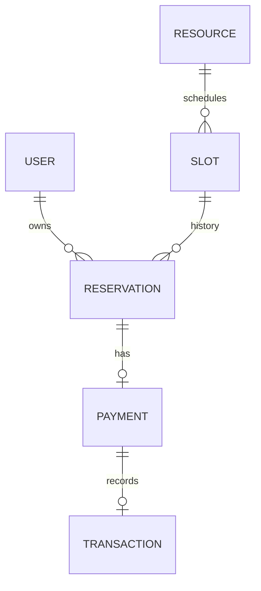

# مدل داده



| جدول | فیلدهای کلیدی و محدودیت |
| --- | --- |
| users | UUID، name، email یکتا و lowercase، password_hash، role |
| resources | UUID، name، description |
| slots | resource_id، starts_at/ends_at UTC، price_irr مثبت؛ منع هم‌پوشانی روی resource در PostgreSQL |
| reservations | user_id، slot_id، amount_irr snapshot، status، created_at؛ یک رزرو فعال برای هر سانس |
| payments | reservation_id یکتا، amount_irr، status، provider_reference یکتا، created_at |
| transactions | payment_id یکتا، reference یکتا، amount_irr، created_at؛ نتیجه موفق تأییدشده |

تمام روابط foreign key دارند و حذف آبشاری اطلاعات مالی وجود ندارد. endpoint حذف فیزیکی در نسخه پایه ارائه نمی‌شود. تراکنش مالی فقط پس از تأیید موفق ساخته می‌شود؛ تلاش ناموفق رکورد موفق ایجاد نمی‌کند و Payment برای تلاش مجدد pending می‌ماند. این جدول دفتر حسابداری دوطرفه نیست.

## ماشین حالت

```text
Reservation: pending -> confirmed
                    -> cancelled
Payment:     pending -> succeeded
```

ایجاد Payment برای رزرو cancelled یا سانسی که شروع شده رد می‌شود. لغو رزرو با Payment pending مجاز است، اما تأیید بعدی رد می‌شود. رزرو پرداخت‌شده برای refund به گردش مستقل آینده نیاز دارد. تأیید تکراری حتی پس از شروع سانس همان نتیجهٔ قبلی را برمی‌گرداند.

## مهاجرت

Alembic منبع ساخت schema است. اپ در startup جدول نمی‌سازد. `alembic upgrade head` پیش از سرویس اجرا می‌شود. migration اولیه همهٔ جدول‌ها، indexها و constraintها را صریح ایجاد می‌کند؛ در PostgreSQL extension استاندارد `btree_gist` برای exclusion constraint لازم است. downgrade دادهٔ این نسخه را حذف می‌کند و فقط روی محیط قابل حذف مجاز است.
