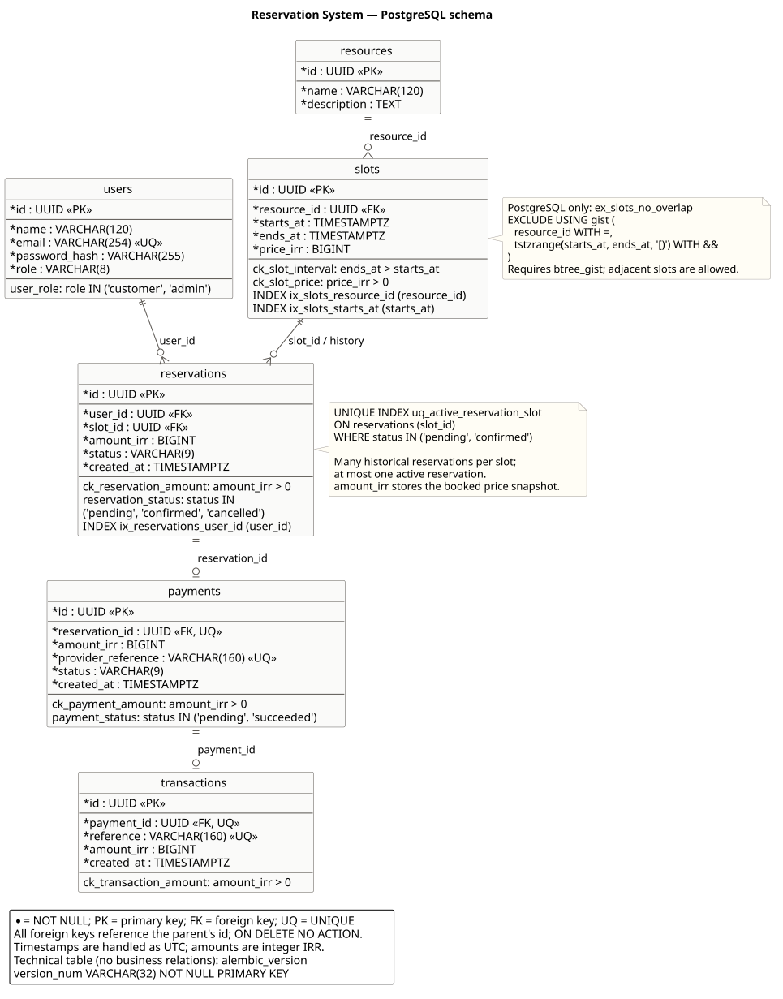

# دیاگرام‌های دیتابیس و کلاس‌ها

اسکریپت‌های PlantUML منبع قابل ویرایش دیاگرام‌ها هستند. فایل‌های SVG کنار آن‌ها برای مشاهده در مستندات و بزرگ‌نمایی نگهداری می‌شوند.

| نما | اسکریپت PlantUML | پیش‌نمایش SVG | منبع تطبیق با کد |
| --- | --- | --- | --- |
| ساختار فیزیکی PostgreSQL، ستون‌ها، روابط و محدودیت‌ها | [database.puml](database.puml) | [database.svg](database.svg) | [migration اولیه](../../backend/migrations/versions/0001_initial.py) و [مدل‌های persistence](../../backend/app/infrastructure/persistence/models) |
| کلاس‌های دامنه، فیلدها، رفتارها و enum وضعیت‌ها | [domain-classes.puml](domain-classes.puml) | [domain-classes.svg](domain-classes.svg) | [موجودیت‌های دامنه](../../backend/app/domain/entities) |
| سرویس‌ها، قراردادهای تزریق وابستگی، آداپتورها و composition root | [application-classes.puml](application-classes.puml) | [application-classes.svg](application-classes.svg) | [application](../../backend/app/application)، [infrastructure](../../backend/app/infrastructure) و [container](../../backend/app/bootstrap/container.py) |

کلاس‌دیاگرام در دو نمای مرتبط آمده تا جزئیات موجودیت‌ها و وابستگی‌های سرویس‌ها خوانا بمانند. نام‌ها در نمودارها با نام‌های کد یکسان‌اند؛ توضیحات داخل نمودار انگلیسی هستند تا خروجی مستقل از پشتیبانی فونت فارسی قابل تولید باشد.

## ساختار دیتابیس



علامت `*` یعنی `NOT NULL`. روابط crow's foot تعداد رکوردهای مجاز را نشان می‌دهند. هر سانس می‌تواند چند رزرو در تاریخچه داشته باشد؛ index جزئی فقط یک رزرو `pending` یا `confirmed` را مجاز می‌کند. هر رزرو صفر یا یک پرداخت و هر پرداخت صفر یا یک تراکنش دارد. رکورد فرزند همیشه به یک رکورد والد موجود متصل است.

نوع فیزیکی زمان‌ها در PostgreSQL برابر `TIMESTAMPTZ` است. enumها با `VARCHAR + CHECK` ذخیره می‌شوند. محدودیت منع هم‌پوشانی سانس فقط در PostgreSQL وجود دارد؛ index جزئی رزرو فعال در PostgreSQL و SQLite تعریف شده است. حداکثر مبلغ و تطابق مبلغ پرداخت با رزرو قواعد دامنه‌اند؛ CHECK دیتابیس فقط مثبت‌بودن مبلغ را تضمین می‌کند. جدول فنی `alembic_version` در راهنمای خود نمودار توضیح داده شده است.

## کلاس‌های دامنه


خط‌چین میان موجودیت‌ها مرجع UUID را مشخص می‌کند؛ به معنی وجود یک فیلد object برای همهٔ روابط نیست. `Reservation.slot` مرجع اختیاری object در حافظه است و در SQLAlchemy به صورت `viewonly` بارگذاری می‌شود. این اختیاری‌بودن در حافظه، رابطهٔ اجباری `reservations.slot_id` در دیتابیس را تغییر نمی‌دهد. متدهای تولیدشدهٔ dataclass و جزئیات `__post_init__` برای اختصار نیامده‌اند.

## سرویس‌ها و قراردادها


فیلدهای هر سرویس تمام وابستگی‌های تزریق‌شدهٔ آن را مشخص می‌کنند. پیکان‌های بین packageها این وابستگی‌ها را تجمیع می‌کنند؛ فلش مثلثی خط‌چین پیاده‌سازی قرارداد `Protocol` است و ارث‌بری صریح پایتون را الزام نمی‌کند. پارامترهای متدها و متدهای کمکی در این نما حذف شده‌اند؛ نوع خروجی حفظ شده است. متدهای آداپتورها مطابق قرارداد مربوط‌اند و تکرار نشده‌اند.

`ApplicationContainer` سرویس‌های یک درخواست را با Repositoryها و `SqlUnitOfWork` متصل به یک Session مشترک می‌سازد. کنترلرهای FastAPI تابع هستند و به صورت کلاس فرضی نمایش داده نشده‌اند. schemaهای HTTP، تنظیمات و سلسله‌مراتب خطاها خارج از محدودهٔ این نمای کلاس هستند؛ مرز لایه‌ها در [مستند معماری](../architecture.md) توضیح داده شده است.

## تولید و بررسی خروجی

Java و [فایل JAR رسمی PlantUML](https://plantuml.com/download) یا دستور نصب‌شدهٔ `plantuml` لازم است. خروجی‌های فعلی با [PlantUML 1.2026.9](https://github.com/plantuml/plantuml/releases/tag/v1.2026.9) و Java 21 ساخته شده‌اند. برای بازتولید از همین نسخه استفاده کنید. هر اسکریپت از موتور داخلی Smetana استفاده می‌کند؛ Graphviz جداگانه لازم نیست و فایل‌ها به سرویس آنلاین فرستاده نمی‌شوند.

از ریشهٔ مخزن در WSL/Linux:

```bash
export PLANTUML_JAR=/absolute/path/to/plantuml-1.2026.9.jar
bash docs/diagrams/render.sh
```

اگر دستور `plantuml` نصب شده باشد، تنظیم متغیر لازم نیست. اسکریپت ابتدا syntax هر سه فایل را بررسی و سپس SVGها را بازسازی می‌کند. `PLANTUML_JAR` در صورت تنظیم بر دستور نصب‌شده اولویت دارد. برای ساخت یک فایل به تنهایی:

```bash
java -Djava.awt.headless=true -jar "$PLANTUML_JAR" \
  -charset UTF-8 -tsvg -nometadata -failfast2 docs/diagrams/database.puml
```

برای تغییر schema یا کلاس‌ها، اسکریپت مرتبط را همراه با کد اصلاح و خروجی‌ها را دوباره تولید کنید. راهنمای رسمی syntax: [روابط دیتابیس](https://plantuml.com/ie-diagram)، [کلاس‌دیاگرام](https://plantuml.com/class-diagram) و [خط فرمان](https://plantuml.com/command-line).
